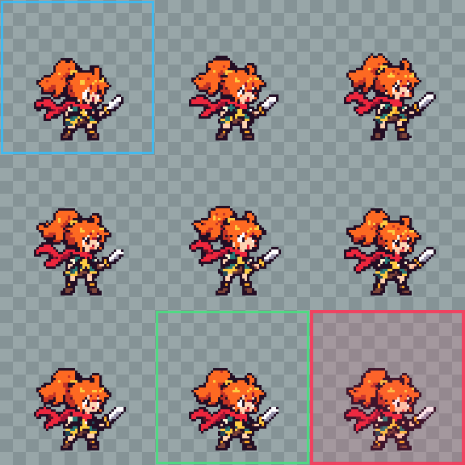
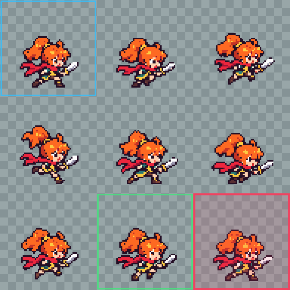
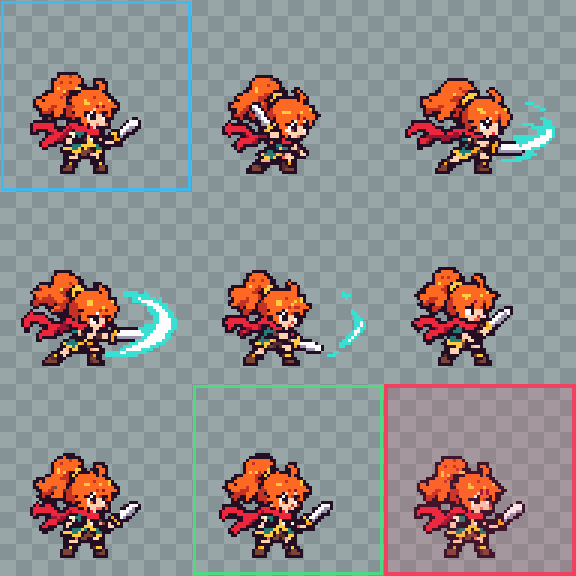
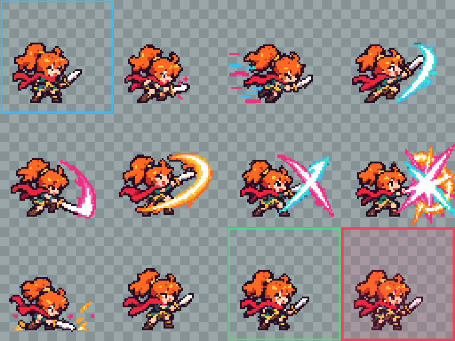
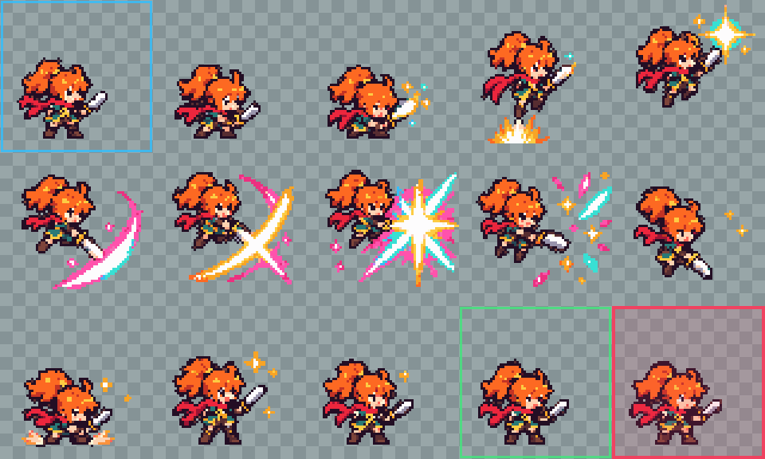

# PixelSprite (v2.1)

> **AI-Native 16-bit Chunky Low-Res Pixel Sprite Pipeline — Body-Isolated Zero-Teleport Quantization (`64×64` Canvas · Fixed `34px` Chibi Height) × Spacious Single-Action Closed-Loop Grids (`3×3` / `4×3` / `5×3`, `N+1` Ghost Anchor) × Variable Frame Counts (`8 / 11 / 14+`) × Selective Hitstop Timing**

把本仓库直接扔给任意 AI 编程助手（Claude Code / Codex / Antigravity / Cursor / Gemini CLI 等），AI 读取 [`AGENTS.md`](./AGENTS.md)、[`CLAUDE.md`](./CLAUDE.md) 与 [`.agents/skills/pixelsprite/SKILL.md`](./.agents/skills/pixelsprite/SKILL.md) 后，即可直接复现整套纯 Python、零浏览器依赖的 16-bit 低像素游戏动画工作流。

---

## v2.1 核心技术架构

1. **角色主体隔离量化（Body-Isolated Quantizer）—— 彻底根治瞬移、缩放漂移、空中压扁与黑边结痂**
   - 自动将角色主体像素（`body_mask`）与高亮技能光效（`vfx_mask`：白/青/金/霓虹粉/星辉紫及附着火光边缘）完全分离：
     - **零横向瞬移**：X 轴严格按角色躯干/头部重心 `body_cx` 对齐（待机/行走/疾跑锁定 `lock_body_x=True`，最大偏移 `0.1–1.2px`；战斗技能平滑限制前冲 `[-1.5, +3.0]px`），巨型刀光再也不会把角色拽飞；
     - **恒定 34px 角色体型 × 64×64 宽裕画布**：保持低像素 Q 版粗颗粒质感不变（角色恒定约 `34px` 高），但画布扩展至 `64×64` 并按 `body_h` 锁定统一缩放比，彻底杜绝大招帧角色缩水或特效裁切；
     - **真实空中抛物线 + 行级地面基线校正**：地面动作严格锁脚底至 `y=57` 消除跨行漂移；跳跃大招自动识别接地行与浮空行，保留平滑真实的腾空高度；
     - **纯净发光特效**：1px 补描边严格仅作用于非特效角色主体，霓虹粉/电光青/流金斩击完全无黑边杂点。
2. **宽裕单动作闭环网格（`N + 1` 幽灵锚点去尾法）—— 绝不再用拥挤 `9×4` 切碎武器**
   - 摒弃会横向压扁角色和切碎长剑的窄列 `9×4`，每个动作独立享有 `>= 307px` 宽的大格网，并在 **第 `1` 格** 与 **第 `N+1` 格（幽灵闭环锚点）** 同步压印半透明母图，生成后自动核验 RGB 贴合度并**剔除第 `N+1` 帧**：
     - **短循环动作（8 有效帧）** `idle` / `walk` / `run` / `combo1_slash` → **`3×3`（`1024×1024` = `341×341`/格）**；
     - **中长多段技能（11 有效帧）** `skill_phantom_flurry` → **`4×3`（`1536×1024` = `384×341`/格）**；
     - **超长浮空奥义（14 有效帧）** `ult_starfall_slash` → **`5×3`（`1536×1024` = `307×341`/格）**。
3. **选择性非均匀帧时间轴（`frameDurationsMs`）**
   - `walk`（`95ms×8`）与 `run`（`75ms×8`）严格 **匀速无停顿**；
   - `idle` 仅在呼/吸顶点柔和停留（`165–170ms`）；
   - `combo1_slash` / `skill_phantom_flurry` / `ult_starfall_slash` 精准配置 **蓄力停顿（`180–195ms`）→ 高速出招爆发（`50–60ms`）→ 命中定帧 HITSTOP（`225–265ms`）→ 急停/胜利收剑定格（`165–215ms`）**。

---

## v2.1 实测法医级验收指标与成品图

| 动作 | 有效帧 + 幽灵帧 | 网格规格 | `F[N]↔F[N+1]` RGB | `F[N+1]↔F1` RGB | 回环 `F[N]→F1` RGB | 最大 X 偏移 | 角色高度区间 | 节奏模式 |
|---|---|---|---:|---:|---:|---:|---|---|
| **待机 `idle`** | `8 + 1` | `3×3` | **93%** | **88%** | **86%** | **0.1px** | `34–37px` | 柔和呼吸 |
| **行走 `walk`** | `8 + 1` | `3×3` | **79%** | **94%** | **80%** | **1.0px** | `32–35px` | 严格匀速 `95ms` |
| **疾跑 `run`** | `8 + 1` | `3×3` | **74%** | **93%** | **74%** | **1.2px** | `32–36px` | 严格匀速 `75ms` |
| **普攻一式 `combo1_slash`** | `8 + 1` | `3×3` | **88%** | **96%** | **90%** | **2.3px** | `32–35px` | 蓄力+横斩 HITSTOP |
| **R·幻影五连乱舞 `skill_phantom_flurry`** | `11 + 1` | `4×3` | **95%** | **92%** | **93%** | **3.9px** | `27–35px` | 蓄力+五连 HITSTOP+急停 |
| **F·星陨次元斩 `ult_starfall_slash`** | `14 + 1` | `5×3` | **89%** | **75%** | **73%** | **2.2px** | `31–39px` | 蓄力+浮空+星爆 HITSTOP+收剑定格 |

### 1. 基础动作闭环核验（`3×3` = `8+1` 帧 · 蓝框=`F1` · 绿框=`F8` · 红框=`F9[=F1/剔除]`）
| 待机 `idle` | 行走 `walk` | 疾跑 `run` | 普攻横斩 `combo1_slash` |
|---|---|---|---|
|  |  |  |  |

### 2. 11 帧中长连招 · `R·幻影五连乱舞`（`4×3` = `11+1` 闭环核验）


### 3. 14 帧超长浮空奥义 · `F·星陨次元斩`（`5×3` = `14+1` 闭环核验）


---

## 快速开始（纯 Python CLI · 零浏览器依赖）

```bash
pip install -r requirements.txt

export PIXELSPRITE_API_URL="https://api.openai.com/v1"
export PIXELSPRITE_API_KEY="sk-..."
export PIXELSPRITE_MODEL="gpt-image-2.6-sunburst"

# 1. 查看画风与宽裕单动作闭环预设
python -m pixelsprite list

# 2. 一键全流程（母图锚点 -> 6套宽裕闭环动作 -> 60 FPS 三轮循环演示视频）
python -m pixelsprite all \
  --desc "你的角色描述" \
  --style gba_chibi \
  --anims idle,walk,run,combo1_slash,skill_phantom_flurry,ult_starfall_slash \
  --loops 3 \
  --out output/hero \
  --video output/hero/showcase_v2.mp4

# 3. 单独重跑或本地零消耗重采样某个动作
python -m pixelsprite action \
  --anchor output/hero/01_anchor_pixel_64px.png \
  --desc "你的角色描述" \
  --anim skill_phantom_flurry \
  --out output/hero
```

*(仓库同样保留 v1 `8×8` 核心 64 帧 + 炫酷技能 64 帧示例于 [`examples/hero_orange_swordswoman/`](./examples/hero_orange_swordswoman/)。)*
