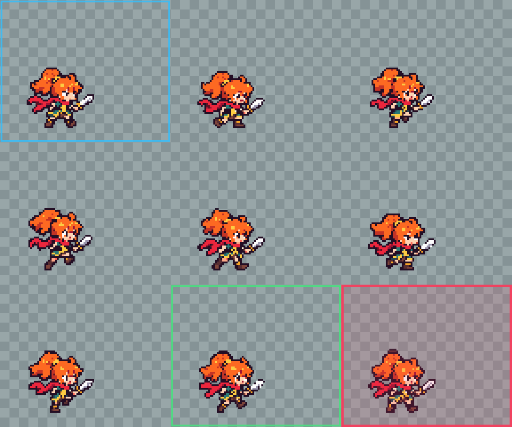
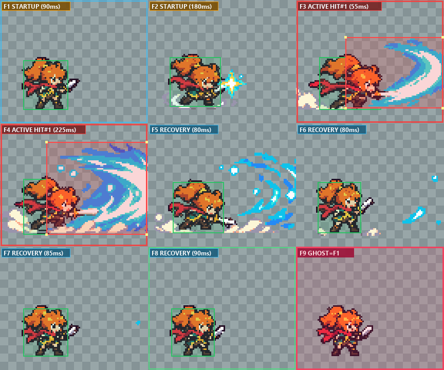

# PixelSprite (v2.3)

> **AI-Native 16-bit Chunky Low-Res Pixel Sprite Pipeline — Strict 5-Dimension Per-Frame Choreography (NEVER Outsource Action Design to Image Models!) × Purposeful Physics-Driven Wide-Arena VFX (`96×80` · Fixed `34px` Chibi) × Auto Pixel-Fitted Attack Frames / Hitboxes / Hurtboxes × Dual-Leg Kinematic Gait Guides × Closed-Loop `N+1` & Hitstop**

把本仓库直接扔给任意 AI 编程助手（Claude Code / Codex / Antigravity / Cursor / Gemini CLI 等），AI 读取 [`AGENTS.md`](./AGENTS.md)、[`CLAUDE.md`](./CLAUDE.md) 与 [`.agents/skills/pixelsprite/SKILL.md`](./.agents/skills/pixelsprite/SKILL.md) 后，即可直接复现整套纯 Python、零浏览器依赖的 16-bit 低像素游戏战斗动画与帧数据管线。

---

## v2.3 第 0 条铁律（核心方法论）：绝不让生图模型“自由发挥”动作与特效！

> **GPT Image 2.6 只负责像素化渲染，动作编排与特效物理语义必须由 AI 编导逐帧设计清楚！**

- **严禁笼统提示词**：绝不能只丢一句“画一个 8 帧走路动画”或“画一个酷炫挥剑技能”让生图模型全权生成——生图模型不懂人体步态和战斗逻辑，笼统提示词必然导致**单脚原地踮步**、**武器与手臂僵硬粘连**以及**脱离挥剑轨迹的无意义光污染特效**。
- **强制 5 维逐帧编排规范（`frame_choreography[]`）**：设计任何新动作前，必须先逐帧写清全部 5 个维度（完整模板见 [`examples/custom_action_template.json`](./examples/custom_action_template.json)，可用 `python -m pixelsprite validate <spec>` 自动校验，生成时支持 `--strict-choreography` 强拦截）：
  1. **`torso`（躯干与重心）**：身体前倾角、蹲沉/起跳高度、蓄力扭肩与斩击甩肩方向、头部视线；
  2. **`arms_weapon`（双手与武器轨迹）**：持武器主手与平衡副手的具体位置、挥砍平面（如自左下向右上挑斩）、行进时的异侧手脚反向摆动；
  3. **`legs_feet`（左右双腿双脚独立轨迹）**：分别写明**近侧前景右腿**与**远侧背景左腿**各自处于着地、承重后滑、垂直中路交叉、蹬地起跳还是前迈位置（配合 `guide.py` 亮黄/亮青双色分腿运动学骨架）；
  4. **`secondary_motion`（随动部件）**：马尾、围巾、衣摆与身体加速度相反的延迟拖尾与回弹；
  5. **`vfx_meaning`（有物理来源与战斗意义的特效）**：
     - 纯移动动作严格为 **`NONE`**（零光效、零杂影）；
     - 战斗特效必须明确回答 **从哪发出（剑刃/鞋底/躯干）+ 沿什么方向运动（贴合挥砍弧线/反向蹬地烟尘）+ 承担什么战斗语义（前摇预警 / 判定帧可视化 Hitbox / 后摇卸力消散）**，杜绝无意义乱堆发光团块。

---

## v2.3 核心工程管线

1. **双色分腿运动学骨架 + 宽裕 `N+1` 闭环网格（`guide.py` / `presets.py`）**
   - 行走/疾跑自动绘制 **亮黄（近侧右腿）vs 亮青（远侧左腿）** Richard Williams 8 帧运动学骨架，强制严格左右脚交替与 F3/F7 中路垂直交叉；
   - `8+1f` 用 `3×3`、`11+1f` 用 `4×3`、`14+1f` 用 `5×3`，生成后核验第 `N+1` 幽灵闭环帧并自动剔除。
2. **游戏引擎级攻击帧与自动像素拟合判定框（`combat.py`）**
   - 导出 100% 干净透明精灵条（`*_96x80.png`），同步在 `*_meta.json` 输出 `startup`/`active`/`recovery` 阶段、伤害/顿帧/击退、绿框受击框（`hurtbox`）与紧贴实际剑光特效拟合的红框攻击判定框（`hitboxes`），并生成可视化核验图 `*_framedata_audit_3x.png`。
3. **角色主体隔离量化 + `96×80` 宽画布（`quantizer.py`）**
   - 角色恒定 `34px` Q 版粗像素质感、统一锚点 `pivot=[30, 71]`、24 色多层次街机光效色板、零横向瞬移、真实空中抛物线与选择性关键帧顿帧（`walk`/`run` 保持严格匀速）。

---

## v2.3 法医级全 6 组验收指标（6/6 PASS）

| 动作 | 帧数 (有效+幽灵) | 5 维编排 | 前摇 / **攻击判定帧** / 后摇 | 段数 & 射程 | `F[N]↔F[N+1]` RGB | `F[N]→F1` RGB | 最大 X 偏移 | 状态 |
|---|---|---|---|---|---:|---:|---:|---|
| **待机 `idle`** | `8 + 1` | `5-DIM OK` | 常态呼吸 | — | **93%** | **86%** | **0.1px** | **PASS** |
| **行走 `walk`** | `8 + 1` | `5-DIM OK` | 严格匀速 `95ms`（双脚严格交替） | — | **76%** | **75%** | **0.5px** | **PASS** |
| **疾跑 `run`** | `8 + 1` | `5-DIM OK` | 严格匀速 `75ms`（双脚交替+双腾空） | — | **72%** | **73%** | **0.6px** | **PASS** |
| **普攻·烈风横斩** | `8 + 1` | `5-DIM OK` | 前摇 `1-2` / **判定 `3-4`** / 后摇 `5-8` | **1 段 · 65px** | **92%** | **87%** | **2.9px** | **PASS** |
| **R·幻影五连乱舞** | `11 + 1` | `5-DIM OK` | 前摇 `1-3` / **判定 `4-8`** / 后摇 `9-11` | **5 段 · 65px** | **91%** | **90%** | **1.8px** | **PASS** |
| **F·星陨次元斩** | `14 + 1` | `5-DIM OK` | 前摇 `1-4` / **判定 `5-9`** / 后摇 `10-14` | **5 段 · 64px** | **71%** | **72%** | **3.2px** | **PASS** |

### 1. 行走 & 疾跑双脚运动学交替核验（`walk` / `run` · F1↔F5 左右脚对调 · F3/F7 中路交叉）
| 行走 `walk`（8+1 帧） | 疾跑 `run`（8+1 帧） |
|---|---|
|  |  |

### 2. 战斗技能宽画布特效 + 绿受击框 / 红攻击判定框核验
- **普攻一式·烈风横斩（8+1 帧）**

- **R·幻影五连乱舞（11+1 帧 · 5 段连续判定）**

- **F·星陨次元斩（14+1 帧 · 5 段浮空判定）**


---

## 快速开始（纯 Python CLI · 零浏览器依赖）

```bash
pip install -r requirements.txt

export PIXELSPRITE_API_URL="https://api.openai.com/v1"
export PIXELSPRITE_API_KEY="sk-..."
export PIXELSPRITE_MODEL="gpt-image-2.6-sunburst"

# 1. 查看全部内置预设与 5 维编排校验状态
python -m pixelsprite list

# 2. 生成新动作前，先校验自定义 5 维逐帧编排 JSON（拒绝笼统提示词！）
python -m pixelsprite validate examples/custom_action_template.json

# 3. 严格按 5 维编排生成单个新动作
python -m pixelsprite action \
  --anchor output/hero/01_anchor_pixel_64px.png \
  --desc "你的角色描述" \
  --anim examples/custom_action_template.json \
  --strict-choreography \
  --out output/hero

# 4. 一键全流程（母图 -> 6套 96x80 闭环精灵 + 攻击判定框帧数据 -> 60 FPS 实时判定框演示视频）
python -m pixelsprite all \
  --desc "你的角色描述" \
  --style gba_chibi \
  --anims idle,walk,run,combo1_slash,skill_phantom_flurry,ult_starfall_slash \
  --loops 3 \
  --out output/hero \
  --video output/hero/showcase_v2.mp4
```

*(仓库同样保留 v1 `8×8` 核心 64 帧 + 炫酷技能 64 帧示例于 [`examples/hero_orange_swordswoman/`](./examples/hero_orange_swordswoman/)。)*
