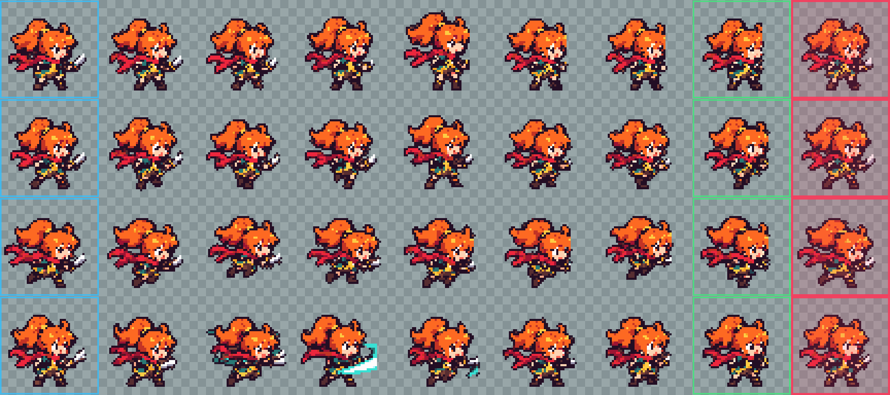
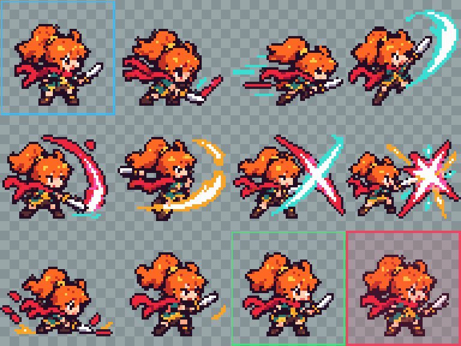
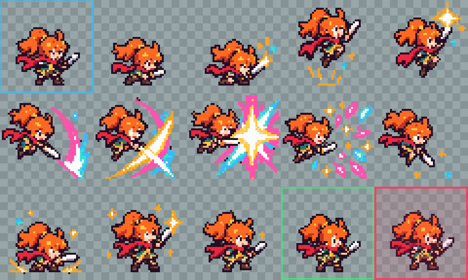

# PixelSprite (v2.0)

> **AI-Native 16-bit Chunky Low-Res Pixel Sprite Pipeline — Closed-Loop `N+1` Ghost Anchor × Variable Frame Counts (`8 / 11 / 14+` Frames) × Selective Keyframe Hitstop Timing**

把本仓库直接扔给任意 AI 编程助手（Claude Code / Codex / Antigravity / Cursor / Gemini CLI 等），AI 读取 [`AGENTS.md`](./AGENTS.md)、[`CLAUDE.md`](./CLAUDE.md) 与 [`.agents/skills/pixelsprite/SKILL.md`](./.agents/skills/pixelsprite/SKILL.md) 后，即可直接复现整套工业级 16-bit 低像素游戏动画工作流。

---

## v2.0 三大核心升级

1. **闭环幽灵锚点生成法（`N + 1` 去尾规则）—— 根治首尾跳帧！**
   - 所有循环动画在生成时都额外多画 **第 `N + 1` 帧（幽灵闭环锚点）**，引导图会在 **第 `1` 格** 和 **第 `N + 1` 格** 同时压印半透明角色锚点，强制 `F[N+1] == F[1]`；
   - 第 `N` 帧夹在 `F[N-1]` 与 `F[N+1](=F1)` 之间自然过渡；导出前程序自动计算 `F[N] ↔ F[N+1]` 与 `F[N] → F[1]` 贴合度并生成闭环校对图（红框标出 `F[N+1]`），随后**自动剔除第 `N + 1` 帧**，保证游戏内 `F[N] → F[1]` 无缝循环、无重帧卡顿。
2. **可变动作帧数 —— 按动作复杂度自由规划（不再局限于 8 帧！）**
   - **基础移动 / 待机 / 轻击**：`8` 有效帧（通过 `9×4` 闭环包生成，每行 `8 + 1` 帧）；
   - **中长多段连招技能**（如 `R·幻影五连乱舞`）：**`11` 有效帧**（`4×3` = `11 + 1` 闭环生成）；
   - **超长华丽大招奥义**（如 `F·星陨次元斩`）：**`14` 有效帧**（`5×3` = `14 + 1` 闭环生成），完整铺开蓄力 → 起跳浮空 → 双重十字星斩 → 次元星爆 → 落地收剑定格 → 回正闭环。
3. **非均匀关键帧时间轴与顿帧（`frameDurationsMs` · 拒绝全动作一刀切！）**
   - **行走 / 疾跑**：严格保持 **匀速节奏**（`95ms` / `75ms`），绝不乱加停顿；
   - **待机**：仅在吸气/呼气顶点柔和停留（`155–160ms`）；
   - **连招与技能大招**：精准赋予 **蓄力停顿（`175–195ms`）→ 高速出招爆发（`50–60ms`）→ 命中定帧 HITSTOP（`220–265ms`）→ 帅气收招定格（`165–215ms`）**，输出标准 Aseprite / 游戏引擎兼容的 `frameDurationsMs` 数组。

---

## v2.0 实测成品（闭环核验图）

### 1. 闭环核心动作 `9×4` 核验图（蓝框=`F1` · 绿框=`F8` · 红框=`F9[=F1/导出时剔除]`）


### 2. 11 帧中长连招 · `R·幻影五连乱舞`（`4×3` = `11+1` 闭环核验 + 蓄力/五连终结 HITSTOP）


### 3. 14 帧超长奥义 · `F·星陨次元斩`（`5×3` = `14+1` 闭环核验 + 浮空滞空/星爆 HITSTOP/收剑定格）


---

## 快速开始（纯 Python CLI · 零浏览器依赖）

```bash
pip install -r requirements.txt

export PIXELSPRITE_API_URL="https://api.openai.com/v1"
export PIXELSPRITE_API_KEY="sk-..."
export PIXELSPRITE_MODEL="gpt-image-2.6-sunburst"

# 1. 查看画风、可变帧数动作与闭环包
python -m pixelsprite list

# 2. 生成（或从立绘转）48×48 低像素锚点母图
python -m pixelsprite anchor --desc "你的角色描述" --style gba_48 --out output/hero

# 3. 生成闭环 9×4 核心包（自动核验 F8↔F9 并剔除第 9 帧）
python -m pixelsprite pack9 \
  --anchor output/hero/01_anchor_pixel_48px.png \
  --desc "你的角色描述" \
  --pack core_9x4_closed \
  --out output/hero/v2

# 4. 生成可变长技能（11+1 帧 / 14+1 帧，或传入自定义 JSON）
python -m pixelsprite action --anchor output/hero/01_anchor_pixel_48px.png --desc "你的角色描述" --anim skill_phantom_flurry --out output/hero/v2
python -m pixelsprite action --anchor output/hero/01_anchor_pixel_48px.png --desc "你的角色描述" --anim ult_starfall_slash --out output/hero/v2

# 5. 渲染 60 FPS 非均匀时间轴 + 首尾闭环核验演示视频
python -m pixelsprite showcase-v2 \
  --metas output/hero/v2/core_9x4_closed_meta.json \
          output/hero/v2/anim_skill_phantom_flurry_11f_meta.json \
          output/hero/v2/anim_ult_starfall_slash_14f_meta.json \
  --out output/hero/v2/showcase_v2.mp4
```

*(仓库同样完整保留 v1 `8×8` 核心 64 帧 + 炫酷技能 64 帧示例于 [`examples/hero_orange_swordswoman/`](./examples/hero_orange_swordswoman/)。)*
