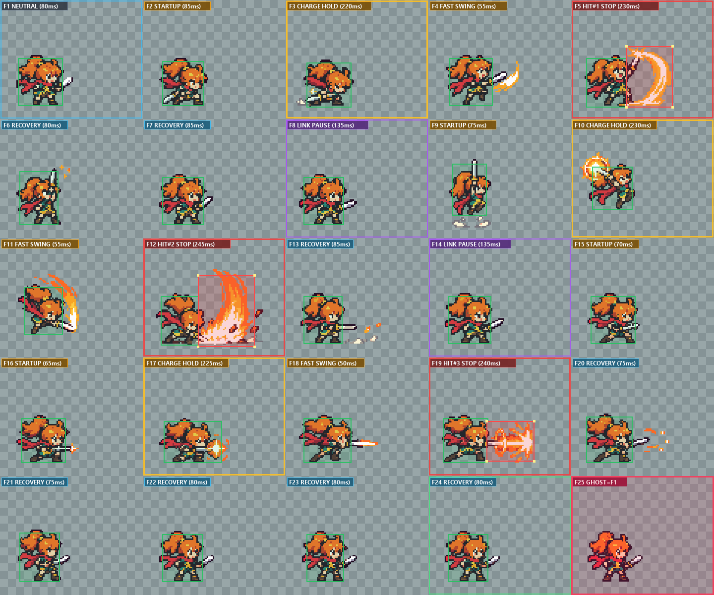
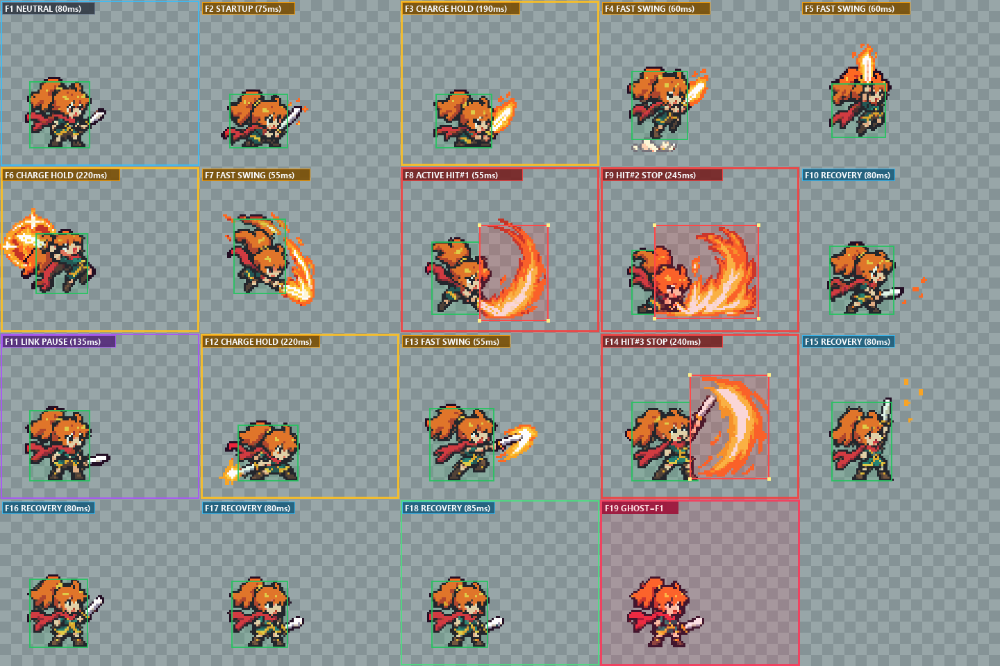

# PixelSprite (v2.6)

> **AI-Native 16-bit Chunky Low-Res Pixel Sprite Pipeline — 6-Dimension Skeletal-Continuity Choreography × Sub-Action Anticipation Law (`子招前摇铁律`) × Tri-Phase Power Rhythm (`三段力量节拍`: 蓄力停顿 → 极速挥动 → 命中定帧 → 正常后摇 → 招间换气) × Calm Grounded Splice Anchor Law (`稳态桥接铁律`) for 18f/24f+ Multi-Part Chained Combos × Monotonic Airborne Parabola & Post-Quantization Continuity Stabilizer × Auto Pixel-Fitted Hitboxes / Hurtboxes**

把本仓库直接扔给任意 AI 编程助手（Claude Code / Codex / Antigravity / Cursor / Gemini CLI 等），AI 读取 [`AGENTS.md`](./AGENTS.md)、[`CLAUDE.md`](./CLAUDE.md) 与 [`.agents/skills/pixelsprite/SKILL.md`](./.agents/skills/pixelsprite/SKILL.md) 后，即可直接复现整套纯 Python、零浏览器依赖的 16-bit 低像素游戏战斗动画与帧数据管线。

---

## v2.6 六大核心工程铁律（`validate` + `quantizer.py` 自动强检）

> **GPT Image 2.6 只当像素渲染器，AI 编导必须先逐帧设计好骨骼衔接、子招前摇、三段力量节拍与物理特效！**

1. **6 维逐帧骨骼编排（`frame_choreography[]`）**
   - 严禁把动作外包给笼统提示词（模板见 [`examples/custom_action_template.json`](./examples/custom_action_template.json)）：逐帧写明 `transition_from_prev`（帧间骨骼衔接链）、`torso`、`arms_weapon`、`legs_feet`（近侧右腿与远侧左腿分离）、`secondary_motion`、`vfx_meaning`（纯移动与桥接帧严格 `NONE`；技能锁定单一元素主题）。
2. **子招前摇铁律（Sub-Action Anticipation Law）**
   - 连招中的**每一段独立攻击**都必须拥有自己的**前摇蓄力帧**与**极速挥动过渡帧**，严禁跳过前摇直接瞬移到下一段命中帧！
3. **三段力量节拍铁律（Tri-Phase Power Rhythm · `timing_mode: "tri_phase_power"`）**
   - 高级技能与多段重招按 **「前摇蓄力停顿（`190–235ms`）→ 极速挥动/空中过程（`50–60ms`）→ 命中打击定帧（`225–245ms`）→ 正常速度后摇收招（`75–85ms`）→ 招间换气衔接停顿（`130–145ms`）」** 编排（可用 `showcase-v2 --power-test` 一键生成「匀速 85ms 对照组 vs 力量节拍正式版 vs 0.5x 慢放骨骼检视」对比视频）。
4. **稳态桥接铁律（Calm Grounded Splice Anchor Law · `2P` / `3P` 多图串联）**
   - 复杂长连招（`18f` / `24f+`）通过 `chained_parts` 多图满分辨率串联（如 `3×3 + 3×3 + 4×3 = 24+1f`）。**每一个跨图桥接帧 `splice_from_prev_frame` 必须落在「稳态直立、完整 34px 身高、零特效（`NONE`）」的换气/过渡帧上**——严禁在蹲伏、腾空、攻击判定或地面残火帧上拼接（根治受击框膨胀与跨图水平跳帧）。
5. **腾空抛物线单调铁律（Monotonic Airborne Parabola Law）**
   - 跳跃类技能必须保持平滑单调的高度曲线（如 `0 → +7 → +14 → +20 顶点 → +12 → +4 → 0`，单帧垂直落差 `|dy| ≤ 10px`），上升帧与顶点蓄力帧姿态必须清晰区分，地面蓄力帧脚底严禁画粗光环拖低 `footY`；`quantizer.py` 已修复全腾空行被误判为地面基线的根因 Bug。
6. **量化后硬性衔接门禁（Post-Quantization Continuity Gate）**
   - `stabilize_sequence_continuity()` 在量化与串联拼接后复测真实像素主体重心与落脚点，自动消除原始抗锯齿边缘引起的水平跳动，严格要求 `[AUDIT PASS]`（`seam_smooth == True`、`maxBodyDX ≤ 4.0px`、`maxBodyDY ≤ 12px`、`MaxHurtW ≤ 38px`、`SPLICE iou ≥ 0.70`）。

---

## v2.6 法医级全 7 组验收指标

| 动作 | 有效+幽灵帧 | 生成架构 | 节拍与元素主题 | 攻击判定帧 & 射程 | 跨图拼缝 `SPLICE` | `F[N]↔F[N+1]` | 最大 X 偏移 | 最大受击框宽 |
|---|---|---|---|---|---:|---:|---:|---:|
| **待机 `idle`** | `8 + 1` | `[1P] 3×3` | 常态呼吸 | — | — | **93%** | **0.1px** | **28px** |
| **行走 `walk`** | `8 + 1` | `[1P] 3×3` | 严格匀速 `95ms` · 双色分腿交替 | — | — | **76%** | **0.5px** | **28px** |
| **疾跑 `run`** | `8 + 1` | `[1P] 3×3` | 严格匀速 `75ms` · 双腿交替+腾空 | — | — | **72%** | **0.6px** | **29px** |
| **ATK J·拔剑横斩** | `8 + 1` | `[1P] 3×3` | 命中定帧 · 青白剑风 | `F3-4`（1 段 · 59px） | — | **85%** | **1.8px** | **30px** |
| **EX Q·三段蓄力破势连斩** | **`24 + 1`** | **`[3P] 3×3+3×3+4×3`** | **三段力量节拍** · 熔金烈钢 | `F5,12,19`（3 段 · 48px） | **`0.71 / 0.74`** | **93%** | **3.3px** | **32px** |
| **SKILL R·居合瞬步五连斩** | **`18 + 1`** | **`[2P] 4×3+3×3`** | 蓄力+定帧 · 电光青白钢风 | `F5,7,9-10,12-13`（5 段 · 65px） | **`0.75`** | **92%** | **2.4px** | **31px** |
| **ULT F·星炎流星坠地斩（v2.6修复）** | **`18 + 1`** | **`[2P] 4×3+3×3`** | **三段力量节拍** · 星金烈焰 | `F8,9,14`（3 段 · 52px） | **`0.82`** | **94%** | **3.4px** | **32px** |

### 1. 24 帧三段力量节拍长动作核验（`EX Q` · `5×5` 闭环 · 3 段无缝串联）
- **蓄力停顿 `F3(220ms) / F10(230ms) / F17(225ms)` · 极速挥动 `50–55ms` · 命中定帧 `F5(230ms) / F12(245ms) / F19(240ms)` · 招间换气 `F8 / F14 (135ms)`**


### 2. 18 帧奥义与居合连招核验（`ULT F` v2.6 抛物线+稳态桥接修复版 & `SKILL R`）
- **ULT F · 星炎流星坠地斩（18+1 帧 · 修复全腾空行基线 + 单调跳抛物线 `F4→F5→F6顶点→F7→F8→F9贯地` + 稳态零特效桥接 `F11` `iou=0.82` + `F12蓄力→F13极速上撩→F14烈焰上挑`）**

- **SKILL R · 居合瞬步三连破空斩（18+1 帧 · 含收腰水平突刺前摇 F8）**


---

## 快速开始（纯 Python CLI · 零浏览器依赖）

```bash
pip install -r requirements.txt

export PIXELSPRITE_API_URL="https://api.openai.com/v1"
export PIXELSPRITE_API_KEY="sk-..."
export PIXELSPRITE_MODEL="gpt-image-2.6-sunburst"

# 1. 查看全部 7 套预设、串联分片([1P]/[2P]/[3P])与 6 维/稳态桥接状态
python -m pixelsprite list

# 2. 生图前强检 6 维骨骼、子招前摇、三段力量节拍与稳态桥接铁律
python -m pixelsprite validate skill_tri_phase_breaker
python -m pixelsprite validate ult_starfall_slash
python -m pixelsprite validate examples/custom_action_template.json

# 3. 严格模式生成 18f / 24f+ 多图串联长动作
python -m pixelsprite action \
  --anchor output/hero/01_anchor_pixel_64px.png \
  --desc "你的角色描述" \
  --anim skill_tri_phase_breaker \
  --strict-choreography \
  --out output/hero

# 4. 生成 3 段式力量感对比测试 MP4（匀速 85ms vs 三段力量节拍 vs 0.5x 慢放检验）
python -m pixelsprite showcase-v2 \
  --metas output/hero/anim_skill_tri_phase_breaker_24f_meta.json \
  --power-test --loops 3 \
  --out output/hero/power_test.mp4

# 5. 一键全流程 -> 60 FPS 全动作实时判定框合集 MP4
python -m pixelsprite all \
  --desc "你的角色描述" \
  --style gba_chibi \
  --anims idle,walk,run,combo1_slash,skill_tri_phase_breaker,skill_phantom_flurry,ult_starfall_slash \
  --loops 3 \
  --out output/hero \
  --video output/hero/showcase_v2.mp4
```
