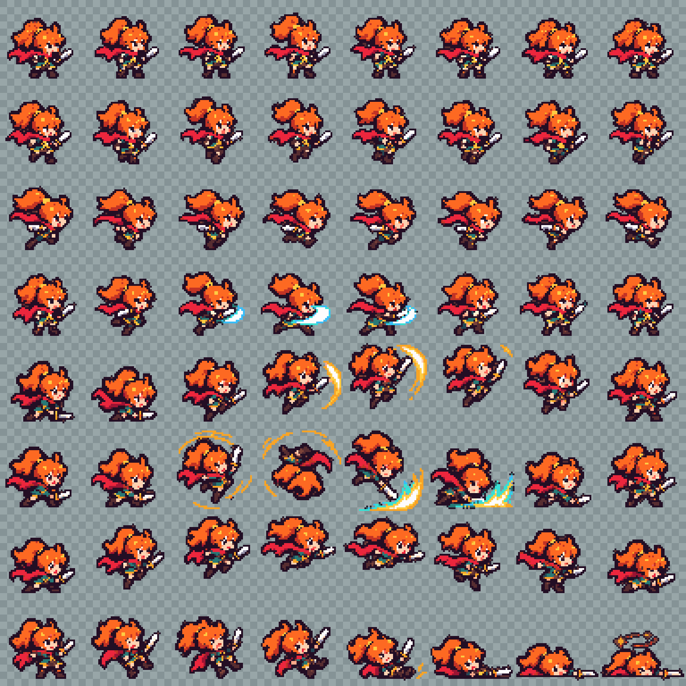
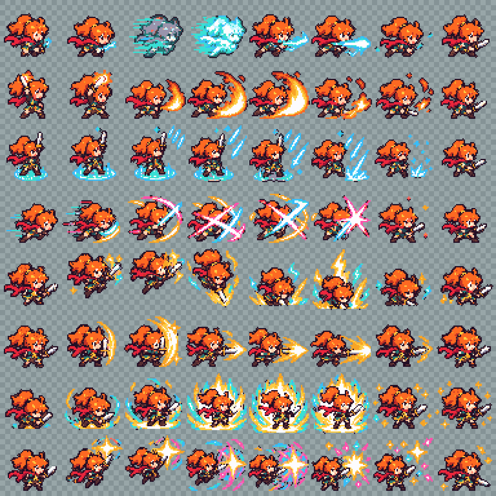

# PixelSprite

> **AI-Native 16-bit Chunky Low-Res `8×8` (64-Frame) Pixel Sprite & Flashy Combat Skill Pipeline for GPT Image 2.6**

把本仓库直接扔给任意 AI 编程助手（Claude Code / Codex / Antigravity / Cursor / Gemini CLI 等），AI 读取根目录的 [`AGENTS.md`](./AGENTS.md)、[`CLAUDE.md`](./CLAUDE.md) 与 [`.agents/skills/pixelsprite/SKILL.md`](./.agents/skills/pixelsprite/SKILL.md) 后，即可直接复现整套 **16-bit 复古低像素 `8×8`（64 帧）角色动作与炫酷技能生成工作流**。

---

## 核心思路（为什么这套工作流既灵动又高度一致？）

1. **拒绝僵硬纸片骨骼，拥抱 32px / 48px / 64px 复古低像素大颗粒**
   - 传统高像素直出图每帧重绘的微弱漂移会被无限放大，而 2D 纸片骨骼又会让动作僵硬、武器像粘在手臂上；
   - 本工作流采用经典的 **16-bit GBA / SNES 二头身 Q 版低像素规格（角色约 32–36 逻辑像素高、14–20 色锁定色板、1px 复古深色轮廓）**，保留手绘动画的充沛生命力（马尾弹跳、围巾飞扬、360° 空中翻滚、炸裂技能光效），同时通过大像素格子天然收敛细微瑕疵。
2. **「先量化母图 → 双 8×4 半表锚定 → NumPy 多数决真像素吸附」三段式管线**
   - **Step 1 · 锚点像素化**：生成或导入角色图后，先立即吸附到 `48×48` 真像素网格并提取 18 色 **Master Palette DNA**，再无损放大作为 Reference Image 1 送入 `/v1/images/edits`，让模型从像素颗粒度到色板 100% 对齐；
   - **Step 2 · 双 8×4 拼接 8×8（64 帧）**：每个动作完整 8 帧独占一整行（消除换行重复腿部的问题），仅需 **2 次 API 调用**即可产出完整 `8×8`（64 帧）动作模组；
   - **Step 3 · Aseprite 级确定性后处理**：自动去底去边框噪点 → 多数决无模糊降采样（零 mixels）→ 下肢重心 X 对齐 + 保留真实跳跃腾空高度 → 母图色板锁色（自动放行白/青/金/烈焰/幻影洋红高光技能色）→ 智能 1px 轮廓修补（绝不加粗已有描边、绝不污染发光特效）。

---

## 实测成品示例（同角色 128 帧：两张完整 `8×8` 大图！）

仓库 [`examples/hero_orange_swordswoman/`](./examples/hero_orange_swordswoman/) 内置了用 `gpt-image-2.6-sunburst` 实测生成的 **128 帧（48×48 真像素）完整角色资产**：

### Sheet 1 · 核心动作与三连剑技 `core_8x8`（64 帧）
> 行 1-8：待机 Idle · 行走 Walk · 疾跑 Run · 普攻一式横斩 · 普攻二式上挑斩 · 普攻三式 360° 旋风跳劈 · 跳跃冲刺 · 受击倒地转星



### Sheet 2 · 炫酷技能与终极奥义 `skills_8x8`（64 帧）
> 行 1-8：`Q` 居合瞬闪斩 · `W` 烈焰剑气波 · `E` 冰晶剑雨阵 · `R` 幻影五连乱舞 · `A` 雷霆天降落雷 · `S` 圣盾格挡反击 · `D` 剑意觉醒爆气 · `F` 终极奥义·星陨次元斩



---

## 快速开始（纯 CLI · 零浏览器依赖）

### 1. 安装依赖（仅 Pillow + NumPy）
```bash
pip install -r requirements.txt
```

### 2. 配置 Image 2.6 API（通过环境变量或本地 `.env`，切勿提交密钥）
```bash
export PIXELSPRITE_API_URL="https://api.openai.com/v1"
export PIXELSPRITE_API_KEY="sk-..."
export PIXELSPRITE_MODEL="gpt-image-2.6-sunburst"
```

### 3. 一键生成完整 128 帧角色（核心 8×8 + 炫酷技能 8×8 + 技能栏 HUD 演示视频）
```bash
python -m pixelsprite all \
  --desc "元气橘发高马尾少女勇者，红围巾，青绿色镶金短风衣，深棕短靴，手持亮银短剑，二头身Q版" \
  --style gba_48 \
  --modules core_8x8,skills_8x8 \
  --export-rows \
  --out output/my_hero \
  --video output/my_hero/showcase.mp4
```

### 4. 更多常用命令
```bash
# 查看内置画风（32/48/64px）与全部 8x8 模组（core_8x8 / skills_8x8 / topdown_8dir_8x8）
python -m pixelsprite list

# 从已有角色立绘转 48px 低像素锚点母图
python -m pixelsprite anchor --input-image my_art.png --style gba_48 --out output/hero

# 单独生成俯视角 8 方向 RPG 奔跑 8×8（64帧）
python -m pixelsprite generate --anchor output/hero/01_anchor_pixel_48px.png --desc "..." --module topdown_8dir_8x8 --out output/hero

# 使用自定义 JSON 扩展任意 Boss / 法师 / 职业技能表
python -m pixelsprite generate --anchor output/hero/01_anchor_pixel_48px.png --desc "..." --module custom_skills.json --out output/hero

# 离线调整像素格子或占格比例（0 API 消耗）
python -m pixelsprite generate --requantize-only --anchor output/hero/01_anchor_pixel_48px.png --desc "..." --module skills_8x8 --cell 64 --fill 0.62 --out output/hero
```

---

## 目录结构

```text
PixelSprite/
├── AGENTS.md                           # 通用 AI Agent 执行规范（Codex/Antigravity/Cursor 等自动读取）
├── CLAUDE.md                           # Claude Code 快捷指令
├── .agents/skills/pixelsprite/SKILL.md # 标准 Agent Skill 定义
├── pixelsprite/
│   ├── presets.py                      # 32/48/64px 风格 DNA、core_8x8 / skills_8x8 / topdown_8dir_8x8 与 Prompt 编译器
│   ├── guide.py                        # 纯 Pillow 8×4 网格、脚底基线与技能光效区域引导图生成器
│   ├── quantizer.py                    # NumPy 多数决真像素吸附、色板 DNA 锁色、跳跃弧线保留、1px 轮廓修补
│   ├── api.py                          # 零三方依赖 OpenAI Images 2.6 客户端（自动兼容 Multipart / JSON 网关）
│   ├── showcase.py                     # 棋盘格 4× 总览图 & 带 ARPG 技能栏 HUD 的演示视频渲染器
│   └── cli.py                          # 命令行入口（anchor / generate / quantize / showcase / all / list）
└── examples/hero_orange_swordswoman/   # 实测生成的 128 帧（Core 8×8 + Skills 8×8）完整成品与元数据
```
