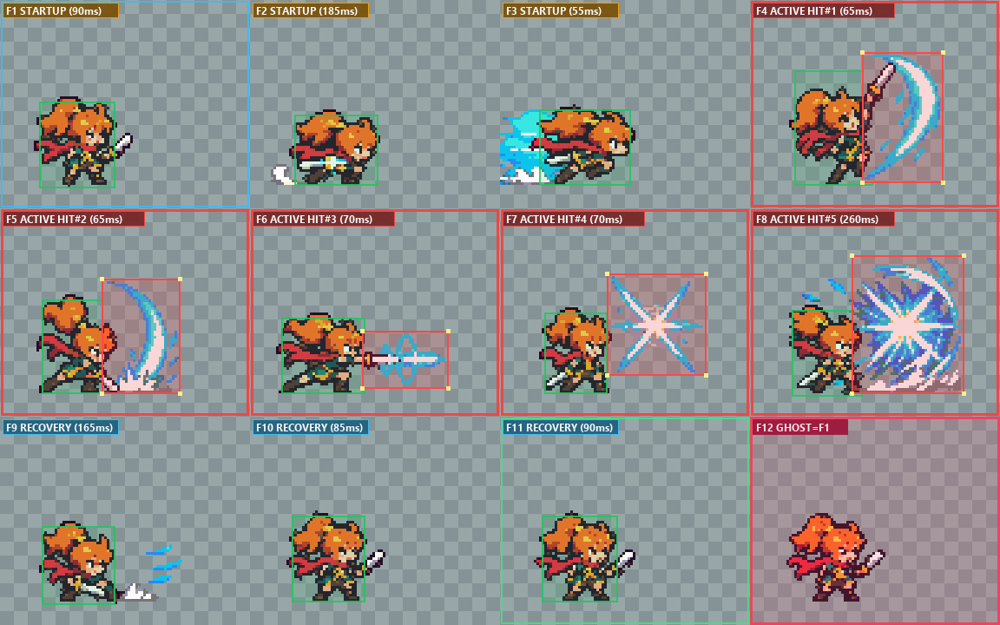
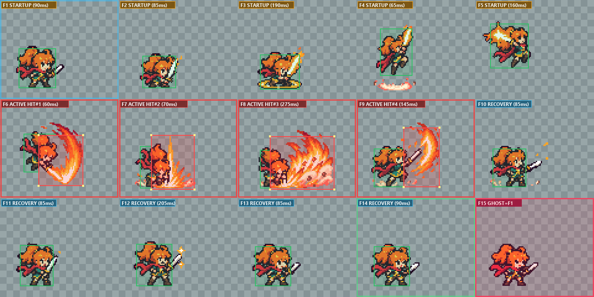

# PixelSprite (v2.2)

> **AI-Native 16-bit Chunky Low-Res Pixel Sprite Pipeline — Wide-Arena Arcade VFX (`96×80` Canvas · Fixed `34px` Chibi Height) × Auto Pixel-Fitted Attack Frames / Hitboxes / Hurtboxes × Spacious Closed-Loop `N+1` Grids × Selective Hitstop Timing**

把本仓库直接扔给任意 AI 编程助手（Claude Code / Codex / Antigravity / Cursor / Gemini CLI 等），AI 读取 [`AGENTS.md`](./AGENTS.md)、[`CLAUDE.md`](./CLAUDE.md) 与 [`.agents/skills/pixelsprite/SKILL.md`](./.agents/skills/pixelsprite/SKILL.md) 后，即可直接复现整套纯 Python、零浏览器依赖的 16-bit 低像素游戏战斗动画与帧数据管线。

---

## v2.2 核心能力

1. **游戏引擎级攻击帧与判定框管线（`pixelsprite/combat.py`）**
   - 每个动作除导出干净透明游戏精灵条（`*_96x80.png`，绝不污染画面）外，同步在 `*_meta.json` 自动输出完整 `combatSummary` 与逐帧 `frameData[]`，并生成可视化判定核验图 `*_framedata_audit_3x.png`：
     - **完整攻击状态机**：清晰划分 `startup`（前摇蓄力）→ **`active`（攻击判定帧，含段数 `hitId`、伤害 `damage`、命中顿帧 `hitstopMs`、击退向量 `knockback`）** → `recovery`（收招后摇）；
     - **绿框·受击框（Hurtbox）**：自动基于隔离后的角色主体像素 `body_mask` 拟合（剔除飘动围巾尖端与长剑剑锋），同时导出格子坐标 `[x, y, w, h]` 与脚底锚点相对坐标 `rel: [dx, dy, w, h]`；
     - **红框·攻击判定框（Active Hitboxes）**：仅在 `active` 攻击帧生成，**直接紧贴实际生成的剑光、残影斩击、烈焰旋风与次元星爆像素自动拟合**，绝非拍脑袋手填。
2. **宽画布多层次街机级特效（`96×80` 统一竞技场 · 角色恒定 `34px` 低像素粗颗粒）**
   - 保持角色本体与之前完全一致的 Q 版 `34px` 粗像素质感，将统一透明画布扩展至 **`96×80`**（脚底锚点统一 `pivot=[30, 71]`），在角色前方留出 **`66px`**、头顶留出 **`40px`** 超宽特效舞台，并升级 **24 色多层次街机光效色板**（白热核 → 电光青/深海蓝、星辉金/烈焰橙/赤红、霓虹粉/次元紫、接地气浪尘烟）：
     - **普攻一式·烈风横斩（8帧）**：蓄力剑芒 + 起步蹬地烟尘 + 巨型多层苍蓝烈风气浪 + 残余能量丝与卷尘；
     - **R·幻影五连乱舞（11帧 · 5段判定）**：接地霓虹法阵 → 疾闪青色残影分身 + 速度线 → 苍岚上挑 → 绯樱下劈震地 → 360° 烈阳火环 → 双影巨型十字斩 → 全屏棱镜星爆终结 + 滑步尘烟；
     - **F·星陨次元斩（14帧 · 5段浮空判定）**：接地金色符文法阵与光柱 → 爆裂起跳冲击坑 → 空中 8 芒星环 → 满屏紫粉次元裂隙斩 → 烈金宇宙十字斩 → 全场彩虹次元星爆 → 漫天星晶碎裂雨 → 震地尘环落地与胜利星光。
3. **宽裕单动作 `N + 1` 闭环去尾 + 角色主体隔离零瞬移 + 选择性顿帧**
   - `3×3` / `4×3` / `5×3` 宽格独立生成 + 第 `N+1` 幽灵闭环锚点核验后自动剔除；
   - `walk`/`run` 保持严格匀速（`95ms`/`75ms`），技能精准配比蓄力停顿、高速快切与命中定帧 HITSTOP；
   - 60 FPS 演示视频实时叠绘绿框受击框、红框攻击判定框、前摇/判定/后摇彩色时间轴与逐帧射程/伤害遥测。

---

## v2.2 法医级全 6 组验收指标（6/6 PASS）

| 动作 | 帧数 (有效+幽灵) | 前摇 / **攻击判定帧** / 后摇 | 攻击段数 & 最大射程 | `F[N]↔F[N+1]` RGB | `F[N]→F1` RGB | 最大 X 偏移 | 状态 |
|---|---|---|---|---:|---:|---:|---|
| **待机 `idle`** | `8 + 1` | 常态呼吸 | — | **93%** | **86%** | **0.1px** | **PASS** |
| **行走 `walk`** | `8 + 1` | 严格匀速 `95ms`（双色分腿运动学交替） | — | **76%** | **75%** | **0.5px** | **PASS** |
| **疾跑 `run`** | `8 + 1` | 严格匀速 `75ms`（双色分腿+双腾空） | — | **72%** | **73%** | **0.6px** | **PASS** |
| **普攻·烈风横斩 `combo1_slash`** | `8 + 1` | 前摇 `1-2` / **判定 `3-4`** / 后摇 `5-8` | **1 段 · 射程 65px** | **92%** | **87%** | **2.9px** | **PASS** |
| **R·幻影五连乱舞 `skill_phantom_flurry`** | `11 + 1` | 前摇 `1-3` / **判定 `4-8`** / 后摇 `9-11` | **5 段 · 射程 65px** | **91%** | **90%** | **1.8px** | **PASS** |
| **F·星陨次元斩 `ult_starfall_slash`** | `14 + 1` | 前摇 `1-4` / **判定 `5-9`** / 后摇 `10-14` | **5 段 · 射程 64px** | **71%** | **72%** | **3.2px** | **PASS** |

### 1. 普攻一式·烈风横斩（`96×80` 宽画布特效 + 绿受击框/红攻击判定框核验）


### 2. R·幻影五连乱舞（11+1 帧 · 5 段连续判定框 + 残影/烈焰旋风/棱镜星爆）


### 3. F·星陨次元斩（14+1 帧 · 符文法阵/空中 5 段判定框/满屏次元裂隙与星爆）


---

## 快速开始（纯 Python CLI · 零浏览器依赖）

```bash
pip install -r requirements.txt

export PIXELSPRITE_API_URL="https://api.openai.com/v1"
export PIXELSPRITE_API_KEY="sk-..."
export PIXELSPRITE_MODEL="gpt-image-2.6-sunburst"

# 1. 查看宽画布预设与攻击判定帧配置
python -m pixelsprite list

# 2. 一键全流程（母图 -> 6套 96x80 闭环精灵 + 攻击判定框帧数据 -> 60 FPS 实时判定框演示视频）
python -m pixelsprite all \
  --desc "你的角色描述" \
  --style gba_chibi \
  --anims idle,walk,run,combo1_slash,skill_phantom_flurry,ult_starfall_slash \
  --loops 3 \
  --out output/hero \
  --video output/hero/showcase_v2.mp4

# 3. 单独生成或本地零消耗重采样某个技能
python -m pixelsprite action --anchor output/hero/01_anchor_pixel_64px.png --desc "你的角色描述" --anim skill_phantom_flurry --out output/hero
```

*(仓库同样保留 v1 `8×8` 核心 64 帧 + 炫酷技能 64 帧示例于 [`examples/hero_orange_swordswoman/`](./examples/hero_orange_swordswoman/)。)*
