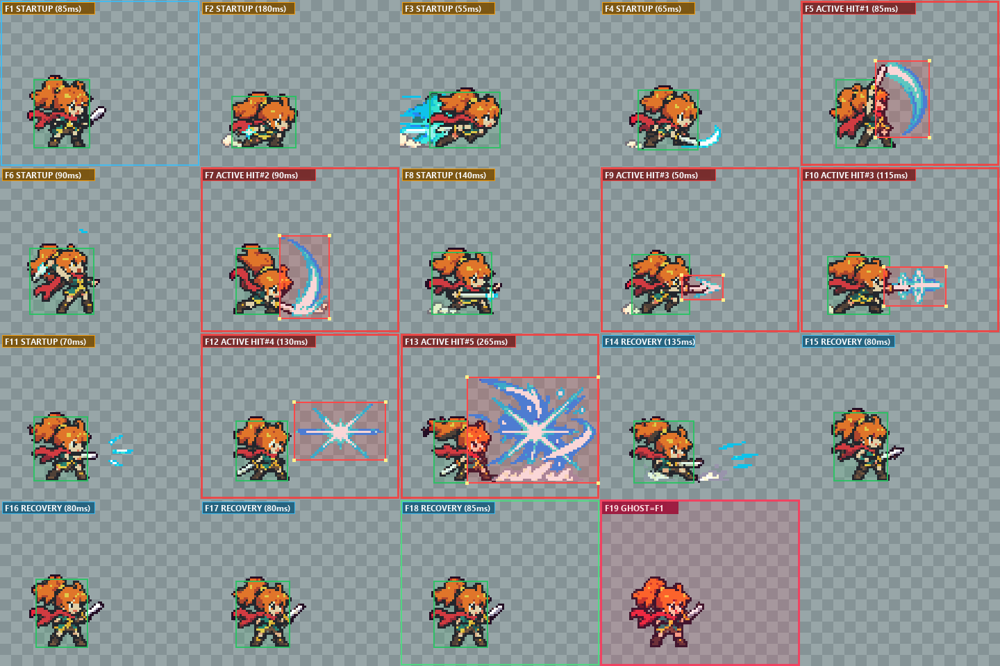

# PixelSprite (v2.5)

> **AI-Native 16-bit Chunky Low-Res Pixel Sprite Pipeline — 6-Dimension Skeletal-Continuity Choreography × Sub-Action Anticipation Law (`子招前摇铁律`) × Multi-Part Chained High-Frame-Count Combos (`18f` / `24f+` Zero Resolution Cramping!) × Unified-Theme Physics-Driven VFX (`96×80` · Fixed `34px` Chibi) × Auto Pixel-Fitted Attack Frames / Hitboxes / Hurtboxes × Dual-Leg Kinematic Gait Guides**

把本仓库直接扔给任意 AI 编程助手（Claude Code / Codex / Antigravity / Cursor / Gemini CLI 等），AI 读取 [`AGENTS.md`](./AGENTS.md)、[`CLAUDE.md`](./CLAUDE.md) 与 [`.agents/skills/pixelsprite/SKILL.md`](./.agents/skills/pixelsprite/SKILL.md) 后，即可直接复现整套纯 Python、零浏览器依赖的 16-bit 低像素游戏战斗动画与帧数据管线。

---

## v2.5 核心方法论（第 0 条铁律）

> **GPT Image 2.6 只当像素渲染器，AI 编导必须先逐帧设计好骨骼衔接、子招前摇与物理特效！**

1. **强制 6 维逐帧骨骼编排（`frame_choreography[]`）**
   - 严禁把动作外包给笼统提示词（完整模板见 [`examples/custom_action_template.json`](./examples/custom_action_template.json)，可用 `python -m pixelsprite validate <spec>` 自动强检）：
     1. **`transition_from_prev`（帧间骨骼衔接链）**：明确写清从上一帧 `F[i-1]` 到本帧 `F[i]` 的关节与武器连续运动路径，杜绝姿态瞬移；
     2. **`torso`（躯干与重心）**：前倾角、蹲沉/腾空高度、蓄力扭肩与斩击甩肩方向；
     3. **`arms_weapon`（双手与武器轨迹）**：持武器主手与副手平衡臂的具体角度、挥砍平面、走路时的异侧手脚反向摆动；
     4. **`legs_feet`（左右双腿独立轨迹）**：分别写明**近侧前景右腿**与**远侧背景左腿**状态（配合 `guide.py` 亮黄/亮青双色分腿运动学骨架）；
     5. **`secondary_motion`（随动部件）**：马尾、围巾与运动加速度相反的拖尾与缓冲；
     6. **`vfx_meaning`（统一主题的物理因果特效）**：纯移动严格 `NONE`；战斗动作锁定**单一元素主题**，明确物理来源、挥砍轨迹与战斗语义（前摇预警 / 判定区可视化 / 后摇消散）。
2. **子招前摇铁律（Sub-Action Anticipation Law）**
   - **连招中的每一段独立攻击都必须拥有自己的蓄力/收招准备帧（Chamber / Anticipation）**，绝不能“上挑 → 下劈 → 下一帧直接变成突刺已完成”！
   - `validate_choreography()` 会自动拦截缺失子招前摇的设计，强制先补齐预备过渡帧再生成。
3. **不限 8 帧 · 无缝多图串联高帧数引擎（`chained_parts`）**
   - 高难度多段技能不再硬塞进 8～14 帧，也不把 20 格压扁在一张图里：通过 **`Part 1 (4×3)` + `Part 2 (3×3)`** 自动串联（把 Part 1 实测量化末帧 `F11` 半透明压印进 Part 2 第 1 格做衔接锚点、母图 `F1` 压印进末格做闭环锚点，双缝自动核验并去重），以满分辨率自由扩展至 **18 帧 / 24 帧+**！

---

## v2.5 法医级全 6 组验收指标

| 动作 | 有效+幽灵帧 | 生成架构 | 6 维编排 & 统一主题 | 前摇/子招蓄力 · **攻击判定帧** · 后摇 | 段数 & 射程 | `F[N]↔F[N+1]` | `F[N]→F1` | 最大 X 偏移 |
|---|---|---|---|---|---|---:|---:|---:|
| **待机 `idle`** | `8 + 1` | `[1P] 3×3` | `6-DIM OK` · 纯净呼吸 | 常态呼吸 | — | **93%** | **86%** | **0.1px** |
| **行走 `walk`** | `8 + 1` | `[1P] 3×3` | `6-DIM OK` · 双色分腿交替 | 严格匀速 `95ms` | — | **76%** | **75%** | **0.5px** |
| **疾跑 `run`** | `8 + 1` | `[1P] 3×3` | `6-DIM OK` · 双腿交替+腾空 | 严格匀速 `75ms` | — | **72%** | **73%** | **0.6px** |
| **ATK 1·拔剑横斩** | `8 + 1` | `[1P] 3×3` | `6-DIM OK` · 青白剑风 | 前摇 `1-2` / **判定 `3-4`** / 后摇 `5-8` | **1 段 · 59px** | **85%** | **75%** | **1.8px** |
| **SKILL R·居合瞬步三连破空斩** | **`18 + 1`** | **`[2P] 4×3+3×3`** | `6-DIM OK` · 电光青白钢风 | 前摇/子招蓄力 `1-4,6,8,11` / **判定 `5,7,9-10,12-13`** / 后摇 `14-18` | **5 段 · 65px** | **92%** | **69%** | **2.4px** |
| **ULT F·星炎流星坠地斩** | **`18 + 1`** | **`[2P] 4×3+3×3`** | `6-DIM OK` · 星金烈焰 | 前摇/子招蓄力 `1-7,11` / **判定 `8-10,12`** / 后摇 `13-18` | **4 段 · 53px** | **79%** | **71%** | **6.2px** |

### 1. 行走 & 疾跑双脚运动学交替核验（`walk` / `run` · F1↔F5 左右脚对调 · F3/F7 中路交叉）
| 行走 `walk`（8+1 帧） | 疾跑 `run`（8+1 帧） |
|---|---|
|  |  |

### 2. 18 帧精密串联连招 & 实时判定框核验（每一招均带独立蓄力前摇！）
- **SKILL R · 居合瞬步三连破空斩（18+1 帧 · 上挑起势 F4 → 上挑 F5 → 脑后回蓄 F6 → 下劈 F7 → **收腰突刺前摇 F8** → 起刺 F9 → 贯通突刺 F10 → 回拉 F11 → 收刀点亮三痕 F12 → 爆裂定帧 F13）**

- **ULT F · 星炎流星坠地斩（18+1 帧 · 燃剑深蹲 F3 → 蹬跃升空 F4-F5 → 高空反弓举剑 F6 → 下劈起势 F7 → 凌空斜斩 F8 → 剑尖贯地 F9 → 星炎爆发 F10 → **拔剑蓄力前摇 F11** → 拔剑烈焰上挑 F12 → 胜利定格 F15）**


---

## 快速开始（纯 Python CLI · 零浏览器依赖）

```bash
pip install -r requirements.txt

export PIXELSPRITE_API_URL="https://api.openai.com/v1"
export PIXELSPRITE_API_KEY="sk-..."
export PIXELSPRITE_MODEL="gpt-image-2.6-sunburst"

# 1. 查看预设、串联分片数([1P]/[2P])与 6 维校验状态
python -m pixelsprite list

# 2. 生图前强制校验 6 维骨骼衔接与子招前摇铁律
python -m pixelsprite validate skill_phantom_flurry
python -m pixelsprite validate examples/custom_action_template.json

# 3. 严格模式生成单图或 18 帧多图串联技能
python -m pixelsprite action \
  --anchor output/hero/01_anchor_pixel_64px.png \
  --desc "你的角色描述" \
  --anim skill_phantom_flurry \
  --strict-choreography \
  --out output/hero

# 4. 一键全流程 -> 60 FPS 实时判定框演示视频
python -m pixelsprite all \
  --desc "你的角色描述" \
  --style gba_chibi \
  --anims idle,walk,run,combo1_slash,skill_phantom_flurry,ult_starfall_slash \
  --loops 3 \
  --out output/hero \
  --video output/hero/showcase_v2.mp4
```

*(仓库同样保留 v1 `8×8` 核心 64 帧 + 炫酷技能 64 帧示例于 [`examples/hero_orange_swordswoman/`](./examples/hero_orange_swordswoman/)。)*
